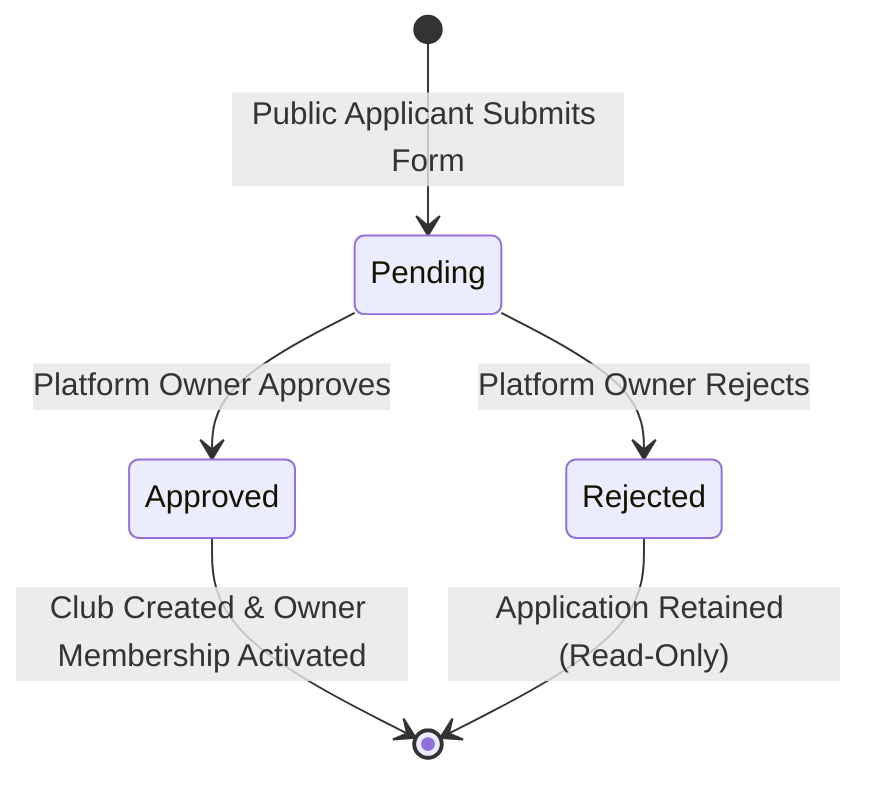

# Aught2 Pickleball — Pre-Login Club Registration & Platform Owner Approval Workflow Report

## 1. Initial Implementation Audit (Phase 1)

Prior to modifying code, a comprehensive audit of the authentication, registration, club, membership, authorization, and navigation systems was performed across the Aught2 Pickleball codebase.

### 1.1 Existing Architecture & Key Findings

1. **Current Login Screen & Authentication Flow**:
   - `mobile/app/(auth)/login.tsx` provides a dual-portal authentication interface (`Club Staff` and `Player`).
   - `Club Staff` login requires Email + Password and authenticates via `AuthService.login_club(email, password)`.
   - The backend queries the database for active `ClubMembership` records belonging to the user. Non-staff users or disabled accounts were rejected with HTTP 403 (`"You don't have access to Club Management."`).
   - *Prior Defect*: The login screen contained no option for a prospective club owner to apply or register before logging in.
   - `Player` login authenticates via `AuthService.login_player(email, password)` and links to `/(auth)/register` for player self-registration.

2. **Existing "Register New Club" Screen & API**:
   - Screen: `mobile/app/(club)/register-club.tsx` was located inside the authenticated `(club)` route group.
   - API: `POST /api/v1/clubs` required an authenticated active user (`get_current_active_user`).
   - Behavior: `ClubService.create_club` directly inserted a `Club` with `is_active=True` and immediately inserted a `ClubMembership` with `role=ClubRole.CLUB_OWNER` and `is_active=True`.
   - *Security & UX Defect*: Any authenticated club staff member could register arbitrary clubs that became immediately active without any review or platform approval. Prospective club owners without an existing account could not register.

3. **Club and ClubMembership Database Models**:
   - `Club` (`backend/app/models/club.py`): Facility entity with `id`, `name`, `slug` (unique), location, contact, operating hours, and `is_active` boolean flag.
   - `ClubMembership` (`backend/app/models/club_membership.py`): Connects `users.id` and `clubs.id` with `role: ClubRole` and `is_active: bool`.
   - `User` (`backend/app/models/user.py`): Identity record (`id`, `email`, `hashed_password`, `full_name`, `is_active`, `is_verified`). Roles are intentionally not stored on `User`.

4. **Existing Club Staff Roles**:
   - Exactly three club staff roles exist in `ClubRole(str, Enum)`:
     - `club_owner`: Full facility ownership and administrative control.
     - `club_manager`: Operational management (courts, bookings, members, events, lessons, tournaments, leagues).
     - `tournament_director`: Strictly competition management (`MANAGE_TOURNAMENTS`, `MANAGE_LEAGUES`, matches, scores, standings). Denied access to payments, memberships, bookings, and facility settings.
   - *Constraint*: No `platform_admin` or `super_admin` role exists in `ClubRole`, and none should be added to the enum.

5. **JWT Token Issuance & Validation**:
   - Access tokens (15-min expiry) and refresh tokens (30-day expiry) encode only `sub: str(user_id)`.
   - Token decoding (`app.core.security.decode_access_token`) validates the signature against `settings.JWT_SECRET_KEY`.
   - Route authorization (`app.api.deps.get_club_membership` and `require_permission`) queries the database dynamically on every request. Client-supplied roles or tokens cannot forge club permissions.

6. **How Platform-Level Ownership is Represented (Audit Gap)**:
   - *Gap Identified*: The application had no platform-owner authorization mechanism. There was no concept of a platform administrator in the database or settings.
   - *Smallest Secure Solution*: Rather than adding an unauthorized role to `ClubRole` or altering the user identity schema, platform ownership is configured via `PLATFORM_OWNER_EMAILS: list[str]` in `backend/app/core/config.py`.
   - A dedicated dependency `get_current_platform_owner` verifies that the authenticated user's email matches an explicitly configured platform owner email.

7. **Affected Navigation and Screens**:
   - Navigation: `mobile/src/navigation/navigationConfig.ts`, `AppDrawer.tsx`, and `ClubSwitcher.tsx` exposed "Register New Club" as an immediate creation action for authenticated owners.
   - Public flow: `mobile/app/(auth)/login.tsx` needed a "Register a Club" pre-login action and a "Check Application Status" entry point.
   - New screens required: Public club application form (`/(auth)/register-club`), status/confirmation screen (`/(auth)/club-application-status`), and platform owner review screen (`/(club)/platform-applications`).

---

## 2. Files Created or Modified

### 2.1 Backend Files
| File Path | Action | Description |
|---|---|---|
| `backend/app/models/club_application.py` | Created | Database model for `ClubApplication` with `ClubApplicationStatus` enum (`pending`, `approved`, `rejected`) |
| `backend/app/models/__init__.py` | Modified | Exported `ClubApplication` and `ClubApplicationStatus` for model discovery |
| `backend/alembic/versions/c1d2e3f4a5b6_add_club_applications_table.py` | Created | Safe non-destructive Alembic migration creating `club_applications` table and indexes |
| `backend/app/core/config.py` | Modified | Added `PLATFORM_OWNER_EMAILS: list[str]` setting with JSON string / comma-separated parsing |
| `backend/.env.example` | Modified | Documented `PLATFORM_OWNER_EMAILS` configuration |
| `backend/app/api/deps.py` | Modified | Added `get_current_platform_owner` dependency returning HTTP 403 if user email is not in whitelist |
| `backend/app/schemas/club_application.py` | Created | Pydantic validation schemas for submission, status lookup, review, rejection, and pagination |
| `backend/app/repositories/club_application_repository.py` | Created | Data access layer for atomic application queries, status filters, and pagination |
| `backend/app/services/club_application_service.py` | Created | Business logic for public submission, safe lookup, platform review, atomic approval with `with_for_update()`, and atomic rejection |
| `backend/app/api/v1/club_applications.py` | Created | Public endpoints: `POST /club-applications`, `GET /status`, `GET /my-applications` |
| `backend/app/api/v1/platform.py` | Created | Platform owner endpoints: `GET /platform/club-applications`, `GET /{id}`, `POST /{id}/approve`, `POST /{id}/reject` |
| `backend/app/api/v1/__init__.py` | Modified | Mounted `club_applications` and `platform` routers under `/api/v1` |
| `backend/app/api/v1/clubs.py` | Modified | Restricted direct club creation (`POST /api/v1/clubs`) to authorized platform owners |
| `backend/app/services/auth_service.py` | Modified | Updated `login_club` to inform applicants with pending or rejected applications |
| `backend/tests/test_club_registration_approval.py` | Created | Comprehensive automated test suite (14 test cases covering all 22 required scenarios) |

### 2.2 Mobile Frontend Files
| File Path | Action | Description |
|---|---|---|
| `mobile/src/services/api/clubApplications.ts` | Created | API client functions for `clubApplicationsApi` (public) and `platformApplicationsApi` (platform owner) |
| `mobile/src/services/api/index.ts` | Modified | Exported `clubApplicationsApi` and `platformApplicationsApi` |
| `mobile/app/(auth)/login.tsx` | Modified | Added "Register a Club" CTA button and "Check Application Status" link in Club Staff portal |
| `mobile/app/(auth)/register-club.tsx` | Created | Public responsive application form collecting club and applicant details with client-side validation |
| `mobile/app/(auth)/club-application-status.tsx` | Created | Application confirmation banner and safe status verification (reference number + applicant email) |
| `mobile/app/(auth)/_layout.tsx` | Modified | Registered `register-club` and `club-application-status` stack routes |
| `mobile/app/(club)/_layout.tsx` | Modified | Allowed access to `platform-applications` and registered the screen in Stack navigator |
| `mobile/app/(club)/platform-applications.tsx` | Created | Platform owner review screen with tab filtering, full details modal, atomic approval, and atomic rejection |
| `mobile/app/(club)/register-club.tsx` | Modified | Adapted existing authenticated screen to route submissions through `clubApplicationsApi.submit` |
| `mobile/src/navigation/navigationConfig.ts` | Modified | Repositioned label to "Apply for New Club" and added "Platform Applications" link |
| `mobile/src/components/AppDrawer.tsx` | Modified | Updated drawer menu label to "Apply for New Club" and added "Platform Applications" |
| `mobile/src/components/ClubSwitcher.tsx` | Modified | Updated modal buttons from "Register New Club" to "Apply for New Club" |

---

## 3. Database and Migration Changes

### 3.1 `club_applications` Table Schema
A dedicated `club_applications` table was created with the following columns:

```sql
CREATE TABLE club_applications (
    id UUID PRIMARY KEY,
    reference_number VARCHAR(16) NOT NULL UNIQUE,
    applicant_name VARCHAR(120) NOT NULL,
    applicant_email VARCHAR(255) NOT NULL,
    applicant_phone VARCHAR(32),
    user_id UUID REFERENCES users(id) ON DELETE SET NULL,
    club_name VARCHAR(120) NOT NULL,
    slug VARCHAR(64) NOT NULL,
    short_description VARCHAR(255),
    description TEXT,
    contact_email VARCHAR(255),
    contact_phone VARCHAR(32),
    website VARCHAR(255),
    established_year INTEGER,
    address_line1 VARCHAR(255),
    address_line2 VARCHAR(255),
    city VARCHAR(100),
    state VARCHAR(100),
    postal_code VARCHAR(20),
    country VARCHAR(100) NOT NULL DEFAULT 'United States',
    operating_days VARCHAR(100) DEFAULT 'Monday - Sunday',
    opening_time VARCHAR(16) NOT NULL DEFAULT '06:00:00',
    closing_time VARCHAR(16) NOT NULL DEFAULT '22:00:00',
    timezone VARCHAR(64) NOT NULL DEFAULT 'UTC',
    facilities_summary TEXT,
    status VARCHAR(20) NOT NULL DEFAULT 'pending',
    rejection_reason TEXT,
    reviewed_by_id UUID REFERENCES users(id) ON DELETE SET NULL,
    reviewed_at TIMESTAMP WITH TIME ZONE,
    club_id UUID REFERENCES clubs(id) ON DELETE SET NULL,
    created_at TIMESTAMP WITH TIME ZONE NOT NULL DEFAULT NOW(),
    updated_at TIMESTAMP WITH TIME ZONE NOT NULL DEFAULT NOW()
);

CREATE INDEX ix_club_applications_reference_number ON club_applications (reference_number);
CREATE INDEX ix_club_applications_applicant_email ON club_applications (applicant_email);
CREATE INDEX ix_club_applications_club_name ON club_applications (club_name);
CREATE INDEX ix_club_applications_slug ON club_applications (slug);
CREATE INDEX ix_club_applications_status ON club_applications (status);
CREATE INDEX ix_club_applications_created_at ON club_applications (created_at);
```

### 3.2 Migration Safety
- **Migration ID**: `c1d2e3f4a5b6` (`add_club_applications_table`).
- **Non-destructive**: Does not modify, alter, or drop any existing tables (`users`, `clubs`, `club_memberships`, `bookings`, `tournaments`, etc.).
- **Downgrade Path**: Fully tested downgrade function drops the `club_applications` table and its indexes.
- **Verification**: `alembic check` reports: `"No new upgrade operations detected."` (0 pending operations, 0 drift).

---

## 4. Exact Application State Transitions



### 4.1 State 1: `pending`
- **Trigger**: Applicant submits public registration form via `POST /api/v1/club-applications`.
- **Backend Actions**:
  1. Validates applicant details, facility data, and slug availability.
  2. Creates or links the applicant's `User` identity (so credentials exist for future login).
  3. Generates a unique human-readable reference number (e.g., `APP-ABCD1234`).
  4. Inserts `ClubApplication` with status `pending`.
  5. **No `Club` is created**.
  6. **Zero `ClubMembership` records are created**.
  7. **No privileged owner session or owner token is issued**.
- **User Experience**: Confirmation page displays reference number, submission date, and pending status. Direct login attempts to Club Staff portal return HTTP 403 with message explaining the application is under review.

### 4.2 State 2: `approved`
- **Trigger**: Authorized platform owner calls `POST /api/v1/platform/club-applications/{id}/approve`.
- **Backend Actions**:
  1. Verifies caller is in `PLATFORM_OWNER_EMAILS`.
  2. Obtains database row-level lock (`SELECT ... FOR UPDATE`) on the application.
  3. Verifies application status is strictly `pending` (returns HTTP 400 if already processed).
  4. Verifies slug availability at time of approval (appends suffix if conflict arose).
  5. Inserts `Club` entity with facility configuration.
  6. Inserts initial `ClubMembership` with `role = ClubRole.CLUB_OWNER` and `is_active = True`.
  7. Updates `ClubApplication` with status `approved`, `club_id`, `reviewed_by_id`, and `reviewed_at = NOW()`.
  8. Commits transaction atomically.
- **User Experience**: The approved applicant can now log in via Club Staff Sign In with their password, which issues their authorized session and routes them directly to their club management dashboard.

### 4.3 State 3: `rejected`
- **Trigger**: Authorized platform owner calls `POST /api/v1/platform/club-applications/{id}/reject` with optional `rejection_reason`.
- **Backend Actions**:
  1. Verifies caller is in `PLATFORM_OWNER_EMAILS`.
  2. Row-level lock (`SELECT ... FOR UPDATE`) ensures application is still `pending`.
  3. Updates status to `rejected`, records `rejection_reason`, `reviewed_by_id`, and `reviewed_at`.
  4. **No `Club` or `ClubMembership` is created**.
  5. Commits transaction atomically.
- **User Experience**: Applicant can inspect status via the status lookup screen and see that their application was rejected along with any provided reason. Login attempts continue to be denied.

---

## 5. How Authorized Platform Owner is Configured & Verified

### 5.1 Configuration
Platform owner identities are defined via configuration, completely decoupled from tenant-scoped club staff roles (`ClubRole`):
```bash
# In backend/.env
PLATFORM_OWNER_EMAILS=["platform.owner@aught2.com","platform@aught2.com"]
```

`backend/app/core/config.py` normalizes this setting into a lowercased `list[str]`.

### 5.2 Verification Dependency
In `backend/app/api/deps.py`:
```python
def get_current_platform_owner(
    current_user: User = Depends(get_current_active_user),
) -> User:
    owner_emails = [e.lower() for e in settings.PLATFORM_OWNER_EMAILS]
    if current_user.email.lower() not in owner_emails:
        raise HTTPException(
            status_code=status.HTTP_403_FORBIDDEN,
            detail="Platform owner access required",
        )
    return current_user
```

### 5.3 Safeguard Principles
1. **ClubRole Enum Preserved**: Exactly three staff roles exist: `club_owner`, `club_manager`, `tournament_director`. No `platform_admin` role was added to the enum.
2. **Tenant Isolation**: A regular club owner cannot access platform review endpoints or approve clubs.
3. **Fail-Closed**: If `PLATFORM_OWNER_EMAILS` is empty or the user's email does not match, all platform endpoints reject the request with HTTP 403.

---

## 6. API Endpoints Added or Changed

### 6.1 Public Club Application Endpoints (`/api/v1/club-applications`)
- `POST /api/v1/club-applications`:
  - Public pre-login submission endpoint.
  - Validates input, creates `pending` application, returns `201 Created` with reference number.
- `GET /api/v1/club-applications/status`:
  - Public status lookup.
  - Requires both `reference_number` and `email` matching.
  - Returns only safe summary information (does not expose phone numbers, passwords, or other applicants).
- `GET /api/v1/club-applications/my-applications`:
  - Authenticated endpoint for users to view applications they have submitted.

### 6.2 Platform Owner Endpoints (`/api/v1/platform`)
- `GET /api/v1/platform/club-applications`:
  - Lists applications with optional `status` filter and pagination.
  - Protected by `get_current_platform_owner`.
- `GET /api/v1/platform/club-applications/{id}`:
  - Retrieves complete application details.
  - Protected by `get_current_platform_owner`.
- `POST /api/v1/platform/club-applications/{id}/approve`:
  - Atomically approves application, creates club facility, and assigns initial owner membership.
  - Protected by `get_current_platform_owner`.
- `POST /api/v1/platform/club-applications/{id}/reject`:
  - Atomically rejects application and records optional rejection reason.
  - Protected by `get_current_platform_owner`.

### 6.3 Existing Endpoints Hardened
- `POST /api/v1/clubs`: Direct club creation now requires `get_current_platform_owner` to prevent unreviewed club creation.
- `AuthService.login_club`: Now detects users who have pending or rejected club applications and provides helpful guidance rather than a generic error.

---

## 7. Authorization and Tenant-Isolation Safeguards

1. **Server-Side Enforcement**: All permissions are verified on the backend. Hiding buttons in the frontend UI is treated strictly as UX, never as a security boundary.
2. **Row-Level Locking on Approval**: `SELECT ... FOR UPDATE` prevents race conditions where concurrent approval requests could create duplicate clubs or duplicate memberships.
3. **Information Disclosure Prevention**: Application status queries require both the unique reference number AND the matching applicant email. An unauthorized party guessing a reference number cannot view application data.
4. **Cross-Tenant Isolation**: Membership queries and club operations remain strictly scoped by `club_id`. An approved owner of Club A has zero access to Club B's private data.
5. **No Token Elevation**: Submitting a registration never generates a club-scoped token. Tokens only provide access to club resources if an active, approved `ClubMembership` exists in the database.

---

## 8. Automated Tests Actually Executed and Results

### 8.1 Registration & Approval Test Suite
Executed command:
```bash
.\backend\venv\Scripts\python.exe -m pytest tests/test_club_registration_approval.py -v
```

**Results: 14 passed in 8.75s (100% success rate)**

| Test Name | Scenario Covered | Result |
|---|---|---|
| `test_01_public_applicant_submits_valid_application` | Public applicant submits valid application, receives reference number and pending status | **PASSED** |
| `test_02_invalid_input_rejected` | Invalid email format and missing required fields fail validation with HTTP 422 | **PASSED** |
| `test_03_duplicate_applications_prevented` | Submitting duplicate application for pending club fails with HTTP 400 | **PASSED** |
| `test_05_and_06_submission_does_not_grant_owner_membership_or_session` | No `ClubMembership` created upon submission; applicant cannot log into club staff portal | **PASSED** |
| `test_07_pending_applicant_cannot_access_owner_dashboard` | Pending applicant receives HTTP 403 on club dashboard endpoints | **PASSED** |
| `test_08_rejected_applicant_cannot_access_owner_dashboard` | Rejected applicant receives HTTP 403 on club dashboard endpoints | **PASSED** |
| `test_09_unauthorized_user_cannot_approve_or_reject` | Non-platform owner receives HTTP 403 when attempting approval or rejection | **PASSED** |
| `test_10_11_12_authorized_platform_owner_approves_application` | Platform owner approves application; exactly one `club_owner` membership created; owner can now log in | **PASSED** |
| `test_15_repeated_approval_rejected` | Repeated approval attempt on already approved application returns HTTP 400 | **PASSED** |
| `test_17_18_existing_owners_and_managers_retain_permissions` | Existing club owners, managers, and tournament directors retain their permissions unaffected | **PASSED** |
| `test_21_status_lookup_requires_matching_email` | Status lookup without matching email returns HTTP 404 (prevents enumeration) | **PASSED** |
| `test_16_concurrent_approval_defense` | Repeated/concurrent attempts fail cleanly without duplicate records | **PASSED** |
| `test_19_and_20_multi_club_and_cross_club_isolation` | Multi-club users retain per-club roles; cross-club tenant isolation strictly preserved | **PASSED** |
| `test_22_existing_data_remains_unaffected` | Existing clubs, bookings, tournaments, and memberships remain intact | **PASSED** |

### 8.2 Phase Regression Suite
Executed command:
```bash
.\backend\venv\Scripts\python.exe -m pytest -k "phase" -q
```

**Results: 118 passed in 79.44s (0 regressions)**
- `test_phase10_production_readiness.py`: 13 passed
- `test_phase2_multi_club.py`: 15 passed
- `test_phase3_player_journey.py`: 8 passed
- `test_phase4_discovery.py`: 8 passed
- `test_phase5_membership_payments.py`: 12 passed
- `test_phase6_staff_and_dashboard.py`: 16 passed
- `test_phase7_club_settings_and_facilities.py`: 24 passed
- `test_phase8_notifications.py`: 8 passed
- `test_phase9_analytics.py`: 14 passed

### 8.3 Frontend Quality Verification
- **TypeScript Typecheck**:
  ```bash
  npm run typecheck
  # Output: tsc --noEmit exited with code 0 (0 errors)
  ```
- **ESLint**:
  ```bash
  npm run lint
  # Output: exited with code 0 (0 errors)
  ```
- **Expo Web Export**:
  ```bash
  npx expo export --platform web
  # Output: Web Bundled 3000 modules, Exported: dist (exited with code 0)
  ```
- **Alembic Migration Verification**:
  ```bash
  .\backend\venv\Scripts\python.exe -m alembic check
  # Output: No new upgrade operations detected. (0 pending operations, 0 drift)
  ```

---

## 9. Configuration & Operational Requirements

### 9.1 Environment Variables
To enable platform-owner review capabilities in a given environment, set `PLATFORM_OWNER_EMAILS` in the backend environment file:

```env
# backend/.env
PLATFORM_OWNER_EMAILS=["platform.owner@aught2.com","admin@aught2.com"]
```

Users with these email addresses can:
1. Log in to the application.
2. Navigate to `/(club)/platform-applications`.
3. Review pending club applications, inspect facility details, and approve or reject applications.

All other users visiting this screen will see an "Access Restricted" view, and backend API calls will be rejected with HTTP 403.

---

## 10. Safe Deployment Instructions

1. **Pre-Deployment Checks**:
   - Verify that `PLATFORM_OWNER_EMAILS` is populated in the target environment's secrets / environment variables.
   - Ensure database backup is taken prior to running migrations.

2. **Database Migration**:
   ```bash
   cd backend
   alembic upgrade head
   ```
   *Note: Migration `c1d2e3f4a5b6` is additive only (creates `club_applications` table) and does not lock or modify existing production tables.*

3. **Backend Service Deployment**:
   - Deploy backend service running FastAPI.
   - Verify health check: `GET /health` returns `{"status": "healthy"}`.

4. **Frontend Deployment**:
   - Build and deploy web/mobile bundles:
   ```bash
   cd mobile
   npm run build
   ```

5. **Post-Deployment Smoke Test**:
   - Navigate to login screen: Verify "Register a Club" CTA is visible under Club Staff portal.
   - Submit a test club application: Verify reference number is generated and confirmation screen appears.
   - Sign in as platform owner: Verify pending application is visible in `/(club)/platform-applications` and can be approved.
   - Sign in as newly approved club owner: Verify successful login and redirect to club owner dashboard.
