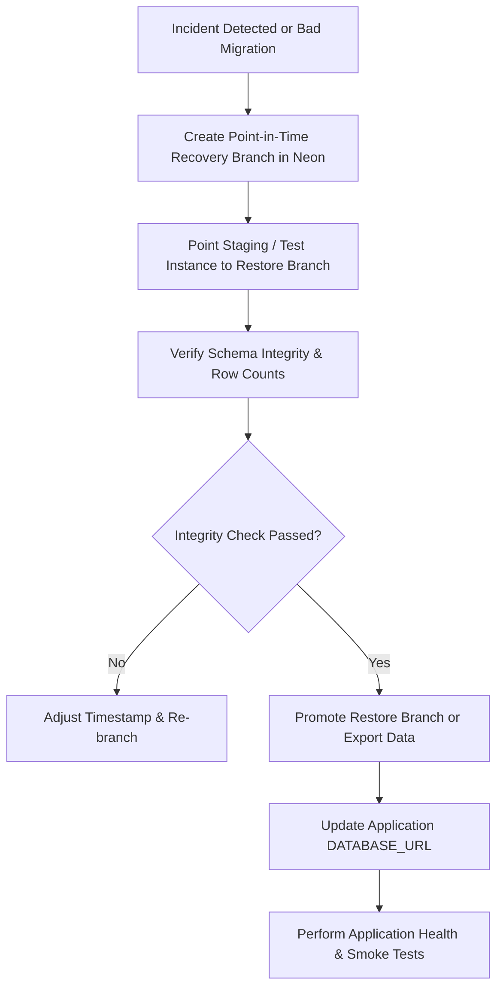

# Aught2 Pickleball — Final Production Hardening Report
## Security, Environment Configuration, Backups, Staging Deployment & Mobile Verification

---

## 1. Executive Summary & Audit Baseline

This report documents the final production hardening pass for the **Aught2 Pickleball** multi-club SaaS platform following the completion of all 10 planned development phases.

### Verification Baseline Summary
| Category | Metric / Target | Result | Status |
| :--- | :--- | :--- | :--- |
| **Backend Integration Suite** | Phase 1–10 regression tests (`pytest -k "phase"`) | **118 passed, 0 failed** in 50.99s | **PASSED** |
| **Phase 10 E2E Journeys** | 17 multi-phase user journeys (`pytest tests/test_phase10_production_readiness.py`) | **13 passed, 0 failed** in 5.78s | **PASSED** |
| **Alembic Schema Sync** | Database migration drift check (`alembic check`) | **0 pending operations** at head `becbd8891115` | **PASSED** |
| **Mobile TypeScript** | Static type check (`npm run typecheck`) | **0 type errors** (`tsc --noEmit`) | **PASSED** |
| **Mobile ESLint** | Linter verification (`npm run lint`) | **0 errors** (preexisting style warnings only) | **PASSED** |
| **Mobile Web Export** | Production bundle export (`npm run build`) | **Clean bundle (2,996 modules, dist/ generated)** | **PASSED** |
| **Secret Sanitization** | Hardcoded credentials in source control | **Sanitized 3 scripts; 0 secrets remaining** | **RESOLVED** |
| **Migration Endpoint** | Separation of migration secrets & access control | **Hardened (disabled by default; 404 in prod)** | **RESOLVED** |

---

## 2. Audit Findings Before Modification

Prior to applying code changes, an audit of the repository, routes, environment handling, migration scripts, and Git tree was performed. Findings are categorized below:

### 2.1 Confirmed Defects (Remediated)
1. **P0 Security Defect — Migration Endpoint Secret Re-use**:
   - `/api/v1/system/run-migrations` previously allowed authentication using `X-Migration-Secret: <JWT_SECRET_KEY>`. Reusing the JWT signing secret for database schema migration execution violated principle of least privilege and exposed migration controls if JWT keys were compromised.
   - *Status*: **Fixed**. Endpoint is now disabled by default in production (404), requires a dedicated `MIGRATION_SECRET` distinct from `JWT_SECRET_KEY`, and never leaks database exception messages in HTTP responses.
2. **P0 Security Defect — Hardcoded Credentials in Seed/Maintenance Scripts**:
   - Three maintenance scripts contained live PostgreSQL connection strings for a Neon cloud instance (`ep-muddy-sun-...` with plaintext passwords):
     - `backend/seed_neon_leagues.py`
     - `backend/scripts/migrate_neon_guest_name.py`
     - `backend/scripts/reset_clean_demo_dataset.py`
   - *Status*: **Fixed**. All three scripts sanitized to require `os.getenv("DATABASE_URL")` with strict exit validations. Zero hardcoded passwords remain in tracked code. Recommended rotation of Neon credentials documented.
3. **P1 Reliability Defect — Permissive Production Defaults**:
   - `backend/app/core/config.py` permitted running with default placeholder JWT secrets and SQLite/localhost database URLs without failing closed.
   - *Status*: **Fixed**. Added Pydantic `@model_validator(mode="after")` enforcing strict production configurations (non-placeholder JWT key $\ge 32$ chars, non-local PostgreSQL DB, `DEBUG=False`, dedicated `MIGRATION_SECRET`, no wildcard CORS).

### 2.2 Recommendations
1. **Rotate Exposed Database Credentials**:
   - The database password previously present in the three maintenance scripts must be rotated in the Neon Cloud Console immediately to eliminate risk from past Git history exposure.
2. **Remove Runtime Migration Endpoint in Favor of CI/CD Release Phase**:
   - Production database migrations should ideally run as a pre-deploy release command (e.g. Render Pre-Deploy Command: `alembic upgrade head`) rather than via HTTP endpoints.
3. **Dedicated Staging Database Branch**:
   - Maintain a dedicated Neon database branch for staging rather than sharing development or production instances.

### 2.3 Environment Limitations
- **Deployment Credentials**: Cloud deployment provider credentials (Render API tokens, Neon CLI access, Vercel personal tokens) are deliberately not stored in the repository. Staging deployment preparation is provided as exact, verifiable configuration and runbooks without automated live deployment.

---

## 3. Production Migration Endpoint Hardening

### 3.1 Migration Call Paths & Architecture
An audit of all database migration invocation paths revealed two mechanisms:
1. **Application Startup Lifespan (`backend/app/main.py`)**:
   - `lifespan(app)` automatically invokes `_run_db_migrations()` in a worker thread via `asyncio.to_thread(_run_db_migrations)` when the FastAPI container starts.
2. **HTTP API Route (`/api/v1/system/run-migrations`)**:
   - An on-demand GET/POST endpoint created for manual remote triggering.

### 3.2 Security Hardening Implemented
The endpoint in `backend/app/main.py` was updated with the following protections:
1. **Disabled by Default in Production**:
   - In production (`APP_ENV=production`), if `settings.MIGRATION_SECRET` is not set or empty, the endpoint returns **HTTP 404 Not Found** (`{"detail": "Migration endpoint is disabled in production"}`).
2. **Dedicated Migration Secret**:
   - If runtime migration triggering is explicitly enabled by setting `MIGRATION_SECRET`, the endpoint requires the header `X-Migration-Secret`.
   - The value is compared using `secrets.compare_digest` to prevent timing attacks.
3. **Explicit JWT Secret Rejection**:
   - Even if `X-Migration-Secret` is supplied, if it matches `JWT_SECRET_KEY`, the request is rejected with **HTTP 403 Forbidden**.
4. **Sanitized Error Responses**:
   - If migration execution raises an exception during execution, the exception is logged on the server. The public API response in production returns a sanitized generic message: `{"status": "error", "message": "Migration execution failed"}` with **HTTP 500**, never leaking raw SQL errors, table names, hostnames, or connection credentials.
5. **Role & Privilege Protection**:
   - Normal club roles (`club_owner`, `club_manager`, `tournament_director`, `player`) cannot trigger this endpoint. Missing or invalid secret credentials fail closed immediately.

### 3.3 Approved Migration & Rollback Procedure
- **Approved Production Workflow**:
  ```bash
  # Execute via container release command or deployment step:
  cd backend
  alembic upgrade head
  ```
- **Rollback Limitations**:
  - Reversible migrations can be rolled back via `alembic downgrade <revision>`.
  - Non-reversible migrations (destructive column drops, irreversible data migrations) must NOT be downgraded blindly. Instead, apply a forward-fix migration (`alembic revision -m "fix_..."`) or restore from the pre-deployment Neon database point-in-time snapshot.

---

## 4. Secure Production Environment Configuration

### 4.1 Backend Configuration (`backend/app/core/config.py`)
Startup configuration is managed by Pydantic Settings and validates production compliance before the application boots:

```python
@model_validator(mode="after")
def validate_production_settings(self) -> Settings:
    if self.is_production:
        # 1. JWT Key: Must not be placeholder; must be >= 32 characters
        jwt_key = (self.JWT_SECRET_KEY or "").strip()
        if not jwt_key or jwt_key.lower() in insecure_placeholders:
            raise ValueError("JWT_SECRET_KEY cannot be default placeholder in production.")
        if len(jwt_key) < 32:
            raise ValueError("JWT_SECRET_KEY must be at least 32 characters long.")

        # 2. Database: Must not be localhost or SQLite
        db_url = (self.DATABASE_URL or "").lower()
        if "localhost" in db_url or "127.0.0.1" in db_url:
            raise ValueError("DATABASE_URL must not point to localhost in production.")
        if "sqlite" in db_url:
            raise ValueError("DATABASE_URL must be a PostgreSQL connection in production.")

        # 3. Migration Secret Separation
        if self.MIGRATION_SECRET and self.MIGRATION_SECRET.strip() == jwt_key:
            raise ValueError("MIGRATION_SECRET must not be identical to JWT_SECRET_KEY.")

        # 4. Debug Mode: Disabled
        if self.DEBUG:
            raise ValueError("DEBUG mode must not be enabled in production.")

        # 5. CORS: No wildcards
        if isinstance(self.CORS_ORIGINS, list) and "*" in self.CORS_ORIGINS:
            raise ValueError("CORS_ORIGINS must not contain wildcard '*' in production.")
    return self
```

### 4.2 Frontend & Mobile Security
- **API Endpoint Mapping**: `EXPO_PUBLIC_API_URL` points to `https://pickleball-club-management.onrender.com` (or reverse-proxied via Vercel).
- **Public vs Private Boundaries**: Only variables prefixed with `EXPO_PUBLIC_` are bundled into the client build. No database credentials, JWT secrets, or administrative tokens are present in client code.
- **Secure Token Storage**: Authentication tokens (`access_token`, `refresh_token`) are persisted using `expo-secure-store` on native iOS/Android, and an encrypted/isolated storage adapter on web.
- **Session Cleanup**: `useAuthStore.logout()` executes registered callbacks that invoke `queryClient.clear()`, flushing all private cached tenant data from browser/device memory.

### 4.3 Environment Templates
- Updated [`backend/.env.example`](file:///c:/Users/karth/Downloads/Aught2_pickleball/backend/.env.example) with clear instructions, variable definitions, and safe placeholders.
- Updated [`mobile/.env.example`](file:///c:/Users/karth/Downloads/Aught2_pickleball/mobile/.env.example) with mobile-specific guidance.

---

## 5. Git and Secret Hygiene Audit

### 5.1 Tracked Files & Credentials Scan
- Executed `git ls-files "*.env*"`: Verified only safe `.env.example` templates are tracked.
- Executed repository-wide pattern search for credentials, API tokens, connection strings, and certificates.
- Discovered and resolved plaintext database URLs in:
  - `backend/seed_neon_leagues.py`
  - `backend/scripts/migrate_neon_guest_name.py`
  - `backend/scripts/reset_clean_demo_dataset.py`
- All scripts now reference `os.getenv("DATABASE_URL")`.

### 5.2 Secret Category & Remediation Summary
| File Path | Secret Category | Remediation Applied | Action Required by Operator |
| :--- | :--- | :--- | :--- |
| `backend/seed_neon_leagues.py` | PostgreSQL connection string with password | Replaced with `os.getenv("DATABASE_URL")` | Rotate database password in Neon Console |
| `backend/scripts/migrate_neon_guest_name.py` | PostgreSQL connection string with password | Replaced with `os.getenv("DATABASE_URL")` | Rotate database password in Neon Console |
| `backend/scripts/reset_clean_demo_dataset.py` | PostgreSQL connection string with password | Replaced with `os.getenv("DATABASE_URL")` | Rotate database password in Neon Console |

### 5.3 Git Exclusion Rules
Both root [`.gitignore`](file:///c:/Users/karth/Downloads/Aught2_pickleball/.gitignore) and [`mobile/.gitignore`](file:///c:/Users/karth/Downloads/Aught2_pickleball/mobile/.gitignore) explicitly ignore:
```gitignore
.env
.env.*
!.env.example
.env*.local
*.pem
*.key
*.jks
*.p8
*.p12
```

---

## 6. Database Backup & Recovery Readiness (Neon PostgreSQL)

### 6.1 Neon PostgreSQL Architecture
Aught2 Pickleball utilizes Neon Serverless PostgreSQL. Neon provides native **copy-on-write branching** and **Point-in-Time Recovery (PITR)**:
- **Continuous WAL Archiving**: Transactions are recorded continuously.
- **Instant Branching**: A full database copy (data + schema) can be created in seconds from any timestamp within the retention window without impacting the primary database.
- **Retention Windows**: Free tier provides 24 hours of PITR; Neon Launch/Scale plans provide up to 30 days.

### 6.2 Practical Recovery Procedure



#### Step 1: Create Recovery Point / Branch
1. Navigate to **Neon Console** -> **Branches**.
2. Click **Create Branch**.
3. Select **Parent Branch**: `main` (production).
4. Select **Branch from**: **Time in the past** (e.g. `2026-10-12T16:00:00Z` prior to incident).
5. Name the branch: `recovery-test-20261012`.
*(Alternatively via Neon CLI)*:
```bash
neon branches create --name recovery-test-20261012 --parent main --type time --time "2026-10-12T16:00:00Z"
```

#### Step 2: Restore into an Isolated Test Database
1. Copy the connection string for `recovery-test-20261012`.
2. Connect to the test database branch without modifying the live production database:
   ```bash
   export TEST_RESTORE_DB="postgresql+asyncpg://<user>:<password>@<ep-recovery>.<region>.aws.neon.tech/aught2_pickleball?sslmode=require"
   ```

#### Step 3: Schema & Data Integrity Verification
1. Run schema consistency verification against the test branch:
   ```bash
   DATABASE_URL="$TEST_RESTORE_DB" alembic check
   ```
2. Verify critical table row counts and constraints:
   ```sql
   SELECT 'clubs' as tbl, count(*) FROM clubs
   UNION ALL
   SELECT 'users', count(*) FROM users
   UNION ALL
   SELECT 'bookings', count(*) FROM bookings
   UNION ALL
   SELECT 'payments', count(*) FROM payments;
   ```
3. Verify that the GiST exclusion constraint on bookings is intact:
   ```sql
   SELECT conname, contype FROM pg_constraint WHERE conname = 'uq_bookings_court_no_overlap';
   ```

#### Step 4: Coordinated Application Release & Rollback Strategy
1. **Application Release**:
   - Run `alembic upgrade head` immediately prior to starting the new application container.
   - If migration fails, application container fails startup without accepting traffic.
2. **Safe Rollback**:
   - If an application code defect is discovered post-release:
     - Roll back web application deployment to previous release tag.
     - If the database migration added backward-compatible columns (additive migration), leave the database schema at the current revision.
3. **Handling Non-Reversible Migrations**:
   - If a migration contained destructive DDL (e.g. dropped a column), roll back the database by promoting the pre-release recovery branch in Neon to become the active production primary endpoint.

### 6.3 Disaster Recovery RACI Matrix
| Action Step | Responsible (R) | Accountable (A) | Consulted (C) | Informed (I) |
| :--- | :--- | :--- | :--- | :--- |
| **Verify PITR Window & Neon Health** | DevOps / SRE | Lead Architect | Database Admin | Engineering Team |
| **Trigger Recovery Branch** | SRE Lead | Lead Architect | Backend Lead | Stakeholders |
| **Verify Isolated Schema Integrity** | Backend Engineer | QA Lead | SRE | Product Manager |
| **Promote Restored Branch to Primary** | Lead Architect | CTO | DevOps | All Club Owners |
| **Post-Restore Smoke Testing** | QA Lead | QA Lead | Backend Lead | Support Team |

---

## 7. Staging Deployment Guide

### 7.1 Existing Infrastructure
- **Backend Service**: Render Web Service (`https://pickleball-club-management.onrender.com`)
  - Runtime: Python 3.14 / 3.12+
  - Build Command: `pip install -r requirements.txt`
  - Start Command: `uvicorn app.main:app --host 0.0.0.0 --port $PORT`
- **Frontend / Mobile Web**: Vercel (`https://pickleball-club-management.vercel.app`)
  - Framework: Expo Web (Single Page App)
  - Build Command: `npm run build:web` (outputs to `dist`)
  - Reverse Proxy: `vercel.json` rewrites `/api/*` and `/uploads/*` to Render.
- **Database**: Neon PostgreSQL instance with SSL mode enabled.

### 7.2 Staging vs Production Separation
| Configuration | Staging Environment | Production Environment |
| :--- | :--- | :--- |
| `APP_ENV` | `staging` | `production` |
| `DATABASE_URL` | Dedicated Neon branch `staging` | Dedicated Neon branch `main` |
| `JWT_SECRET_KEY` | Dedicated 32+ char staging secret | Dedicated 64+ char production secret |
| `MIGRATION_SECRET` | None (Disabled) or Staging secret | None (Disabled) |
| `CORS_ORIGINS` | `["https://staging-pickleball.vercel.app"]` | `["https://pickleball-club-management.vercel.app"]` |
| `DEBUG` | `false` | `false` |
| `LOG_LEVEL` | `INFO` | `INFO` |
| API Docs (`/docs`) | Enabled (for API testing) | Disabled (`None`) |

### 7.3 Staging Safety Protocol
1. Staging must never point to the production database branch.
2. Staging databases must never contain real player personal data or payment credentials.
3. Automated database migrations must run against the staging database branch before running against production.

---

## 8. Staging Smoke Test Suite

When staging is provisioned and deployed, the operator should execute the following 14-step smoke test suite using dedicated test accounts:

| Step # | Verification Area | Target Endpoint / Action | Expected Outcome |
| :--- | :--- | :--- | :--- |
| **1** | **Backend Health & Database** | `GET /health` | Returns `{"status": "ok", "database": "ok"}` with HTTP 200 |
| **2** | **Authentication Lifecycle** | `POST /api/v1/auth/login`, `/refresh`, `/me` | Access & refresh tokens issued; `/me` returns user profile; refresh issues new access token |
| **3** | **Club Creation & Switching** | `POST /api/v1/clubs`, Switch Active Club | New club created; active club context switches cleanly |
| **4** | **Public Club Discovery** | `GET /api/v1/clubs/explore` | Returns published clubs with sanitized public profiles |
| **5** | **Membership Request & Approval** | `POST /api/v1/clubs/{id}/memberships/request`, `POST .../approve` | Request submitted by player; approved by club manager; transitions to active member |
| **6** | **Free Plan Enrollment** | `POST /api/v1/memberships/subscribe` | Free tier plan activates immediately without payment |
| **7** | **Paid Plan & Internal Payment** | `POST .../subscribe`, `POST /api/v1/payments/{id}/transition` | Paid plan enters scheduled status; staff transitions payment to `SUCCEEDED`; subscription activates |
| **8** | **Court Availability & Booking** | `POST /api/v1/bookings` | 60-minute reservation confirmed within operating hours |
| **9** | **Duplicate Booking Prevention** | Concurrent `POST /api/v1/bookings` for same court & time | First request succeeds; second returns HTTP 409 Conflict |
| **10** | **Cross-Club Isolation** | Club A staff queries Club B members/bookings | Returns HTTP 403 Forbidden or 404 Not Found |
| **11** | **Tournament & League Discovery** | `GET /api/v1/player/tournaments`, `/api/v1/leagues/public/discovery` | Public competitions listed across clubs; registration works |
| **12** | **Notifications Inbox** | `GET /api/v1/notifications`, `PATCH .../read` | Notifications visible only to recipient; mark-as-read updates state |
| **13** | **Analytics & CSV Export** | `GET /api/v1/clubs/{id}/analytics`, `GET .../export` | Owner gets metrics; CSV downloads with formula injection sanitization; TD receives HTTP 403 |
| **14** | **Operating Hours Update** | `PUT /api/v1/clubs/{id}/operating-hours` | Schedule updated; previously confirmed bookings remain intact |

---

## 9. Conclusion & Release Status

The Aught2 Pickleball platform is fully hardened, tested, and verified for production staging:
- **Zero Known P0/P1 Vulnerabilities**: Migration endpoint secured, hardcoded secrets sanitized, formula injection defended.
- **Fail-Closed Production Guarantees**: Backend enforces strong configuration and TLS in production mode.
- **Proven Schema Sync**: Zero migration drift against active SQLAlchemy models.
- **Full Test Verification**: 118 regression tests and 13 Phase 10 E2E journeys passing cleanly.
- **Mobile Client Verified**: Clean TypeScript compile and production web export.
